# dockerfile-lint

dockerfile-lint reads Dockerfiles the way the builder does (line continuations, comments, multi-stage builds) and reports the choices that weaken the resulting image or its build: a container that runs as root, base images that are not pinned, remote scripts piped into a shell, credentials baked into layers and TLS verification switched off. Each finding has the file and the line where the instruction starts.



**Live demo:** https://jvch0512.github.io/dockerfile-lint/ (Synthetic Dockerfiles.)

Kotlin (JVM), standard library only. The demo page is rendered from the tool's `--tsv` output by `scripts/site.py` (Python 3, only needed to regenerate the page).

## Use

```bash
make build
java -jar build/dockerfile-lint.jar examples
java -jar build/dockerfile-lint.jar Dockerfile --tsv
java -jar build/dockerfile-lint.jar ./services --fail-on high   # exit 1 on any high finding
```

Pass a file or a directory (files named `Dockerfile`, `Dockerfile.*` or `*.dockerfile`, searched recursively).

| Rule | Severity | What it catches |
|---|---|---|
| DKR001 | high | final stage has no `USER`, or ends as `root` |
| DKR002 | medium | `FROM` without a tag or with `:latest` (digests and stage aliases are fine) |
| DKR003 | high | `curl` or `wget` piped into `sh` or `bash` |
| DKR004 | medium | `ADD` from a URL; low for `ADD` of local files that are not archives |
| DKR005 | high | `ENV` or `ARG` that sets a password, secret, token or key |
| DKR006 | low | `apt-get install` without `--no-install-recommends` |
| DKR007 | medium | `chmod 777` |
| DKR008 | low | no `HEALTHCHECK` in the final stage |
| DKR009 | medium | `sudo` inside the image build |
| DKR010 | medium | `EXPOSE 22` |
| DKR011 | medium | TLS checks disabled (`curl -k`, `--insecure`, `--no-check-certificate`, `strict-ssl false`) |
| DKR000 | info | no `FROM`, or an instruction that Docker does not know |

See [examples](examples) and [docs/sample-output.txt](docs/sample-output.txt).

## Limits

- Variables in `FROM` (`FROM ${BASE}`) are not resolved, so DKR002 skips them.
- Only the final stage is judged for `USER` and `HEALTHCHECK`, because that is what ships.
- It reads the text of the Dockerfile. It does not look at the build context, at `.dockerignore` or at the image that results.
- Heredoc `RUN <<EOF` bodies are treated as ordinary lines of the instruction.

## Where it fits

Container build review: a pre-merge gate for Dockerfiles and a quick inventory of risky images on inherited estates.

## Tests

```bash
make test    # 74 checks, incl. 3000-case fuzzing and CLI exit codes
```

MIT.

## Code scanning (SARIF)

`scripts/tsv2sarif.py` converts the `--tsv` output into SARIF 2.1.0, so findings show up in GitHub code scanning:

```sh
java -jar build/dockerfile-lint.jar examples --tsv 2>/dev/null | python3 scripts/tsv2sarif.py --tool dockerfile-lint --prefix examples > results.sarif
```

Upload `results.sarif` with `github/codeql-action/upload-sarif`. Severities map to SARIF levels (critical and high to error, medium to warning, low and info to note) and to a `security-severity` score.

## Validated on real data

This tool was run on public corpora and the false positives it produced were fixed. Corpus, counts and bugs found are in [docs/validation.md](docs/validation.md).
